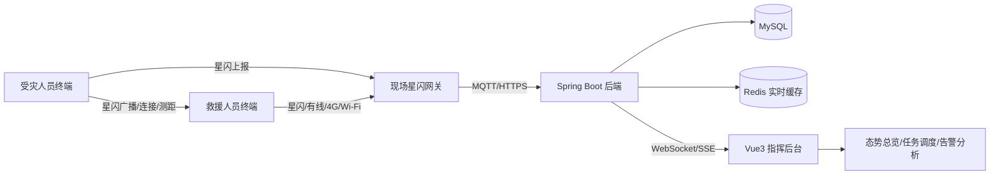
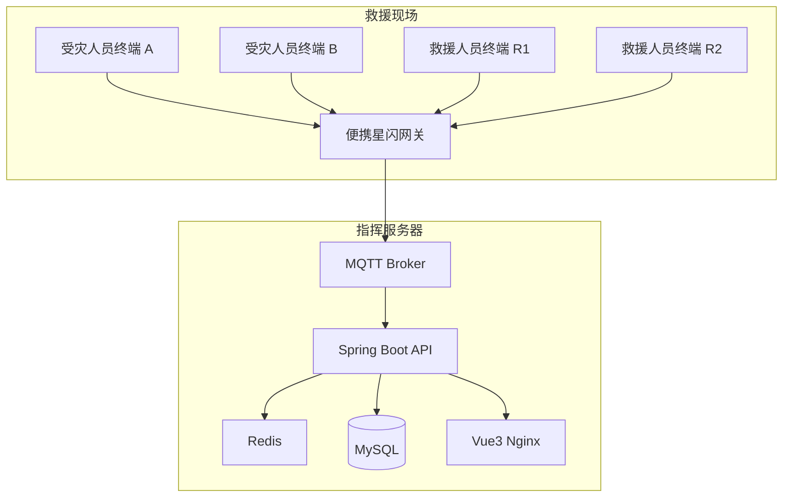
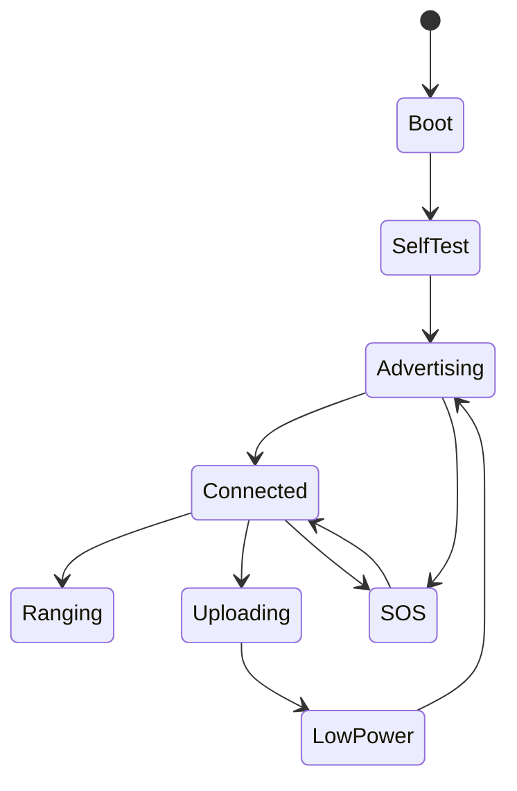
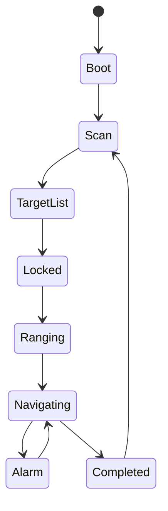
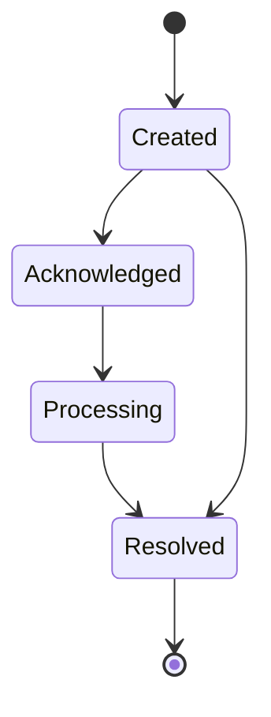

# 基于星闪互联的灾后救援系统开发文档

## 1. 项目概述

### 1.1 项目名称

基于星闪 NearLink 的灾后生命搜救与安全调度系统。

### 1.2 项目目标

本项目面向地震、矿难、火灾、坍塌、隧道事故等灾后救援场景，构建一套由受灾人员佩戴终端、救援人员导航终端、现场网关和 Web 指挥后台组成的搜救系统。

系统通过星闪 NearLink 实现近距离低时延互联、测距和定位辅助；通过生命体征传感器采集受灾人员血氧、心率、血压趋势等数据；通过救援人员终端采集温湿度、可燃气体等环境风险数据；通过 Spring Boot、Vue3、MySQL 后台进行态势管理、告警推送和救援优先级分析。

### 1.3 核心价值

- 在公网中断、Wi-Fi 不稳定、蓝牙抗干扰不足的灾后环境中，提供本地化短距搜救通信能力。
- 救援人员无需依赖后台，也能通过手持/腕戴终端发现受灾人员并获取距离、方向趋势和安全告警。
- 指挥后台能够统一查看受灾人员生命状态、位置状态和救援任务状态。
- 通过生命体征、位置、环境风险、数据可信度综合计算救援优先级，辅助指挥决策。
- 系统可以从两块板子的演示原型逐步扩展为多终端、多网关、多锚点的工程系统。

## 2. 设计原则

### 2.1 工程可落地

项目中所有能力按三级定义：

- 原型演示级：两块星闪开发板互联，完成身份广播、测距、生命体征采集和屏幕显示。
- 项目交付级：加入救援人员终端、环境传感器、后台管理系统、实时 WebSocket 推送和救援优先级算法。
- 工程增强级：加入多锚点定位、便携网关、中继组网、工业级气体传感器、防护外壳和现场校准流程。

### 2.2 本地自治优先

灾后救援现场可能断网，因此关键功能必须在本地终端完成：

- 救援人员终端本地显示受灾人员距离。
- 救援人员终端本地显示方向箭头或距离变化趋势。
- 环境危险本地声光震动报警。
- 目标锁定、本地搜救和紧急撤离不依赖 Web 后台。

Web 后台用于指挥调度、全局态势、历史记录和优先级分析，不作为生命安全功能的唯一依赖。

### 2.3 数据可信度明确

血氧、心率、血压估算、气体检测、定位结果都需要携带数据质量字段。系统界面必须展示或隐式使用质量评分，避免把低质量数据当作确定结论。

### 2.4 医疗和安全边界

本系统定位为救援辅助系统，不替代医疗诊断设备。血压估算应称为趋势辅助，量产或正式救援使用前需要经过医疗器械级验证。可燃气体检测在演示阶段可使用低成本模块，工程阶段必须替换为工业级 LEL 传感器，并建立校准和 bump test 流程。

## 3. 星闪能力边界与选型建议

### 3.1 星闪链路定位

星闪 NearLink 可用于低时延、高可靠、抗干扰的近距离通信，并支持面向高精度定位和同步的能力扩展。项目中建议按以下方式使用：

- SLE：低功耗设备连接、身份广播、传感器数据上报、终端交互。
- SLP：若开发板或模组支持，用于高精度测距/定位。
- 星闪网关：汇聚多个受灾终端和救援终端数据，并上报后台。

### 3.2 两板互联的现实能力

两块普通星闪板子通常可以稳定做通信和测距，但不能天然直接得到完整 3D 方向。方向箭头有三种落地路径：

| 方案 | 硬件要求 | 能力 | 推荐阶段 |
| --- | --- | --- | --- |
| 距离趋势导航 | 两块普通星闪板 + IMU | 通过移动后的距离变化估算方向 | 原型阶段 |
| 多天线/定向天线 | 救援终端增加天线阵列或定向天线 | 更快估算方位角 | 高端样机 |
| 多锚点定位 | 3 个以上现场锚点/网关 | 直接计算目标坐标 | 工程增强 |

### 3.3 推荐硬件组合

第一版建议采用：

- 受灾人员终端：星闪模组 + PPG 血氧心率 + 气压/体温可选 + 加速度计 + SOS + 电池。
- 救援人员终端：星闪模组 + 屏幕 + IMU + 温湿度 + 可燃气体 + 蜂鸣器/震动/LED。
- 网关：星闪模组 + Linux/ESP32/MCU 主控 + 4G/Wi-Fi/以太网 + MQTT。
- 后台：Spring Boot + MySQL + Redis + Vue3。

## 4. 系统总体架构

### 4.1 逻辑架构



### 4.2 数据流

1. 受灾人员终端周期广播设备 ID、人员 ID、生命体征摘要、电量和告警状态。
2. 救援人员终端扫描周围受灾终端，选择目标后发起测距。
3. 救援人员终端融合测距、IMU、电子罗盘，估算目标方向和距离。
4. 现场网关汇聚受灾终端、救援终端和环境数据。
5. 后端通过 MQTT/HTTPS 接收实时数据，写入 Redis 和 MySQL。
6. 后端通过 WebSocket 推送给 Vue3 指挥后台。
7. 后台计算救援优先级并生成调度建议。
8. 指挥员可以向救援人员终端下发目标锁定和任务指令。

### 4.3 部署架构



## 5. 硬件端设计

### 5.1 受灾人员终端

#### 5.1.1 功能

- 星闪身份广播。
- 与救援人员终端或网关建立连接。
- 采集血氧、心率、血压趋势、体温或皮温。
- 检测跌倒、静止、佩戴状态。
- SOS 主动求救。
- 低电量报警。
- 本地震动或蜂鸣反馈。

#### 5.1.2 推荐模块

| 模块 | 推荐类型 | 说明 |
| --- | --- | --- |
| 主控 | 支持星闪开发板或 MCU + 星闪模组 | 优先使用官方 SDK 支持完善的开发板 |
| 血氧心率 | MAX30102/MAX30105/AFE44xx 类 | 演示可用，工程需重视抗运动干扰 |
| 血压 | PPG 趋势估算或小型腕式气囊模块 | 正式测量优先气囊震荡法 |
| IMU | BMI270/MPU6050/ICM42688 类 | 跌倒、静止、佩戴状态 |
| 温度 | 皮温/环境温度传感器 | 辅助判断 |
| 电源 | 锂电池 + 充电管理 + 电量计 | 支持低功耗模式 |
| 交互 | SOS 按键 + LED + 震动 | 简单可靠 |

#### 5.1.3 采样策略

| 数据 | 采样频率 | 上报频率 | 说明 |
| --- | --- | --- | --- |
| 血氧 | 25-100 Hz 原始采样 | 1 Hz 结果上报 | 需输出信号质量 |
| 心率 | 25-100 Hz 原始采样 | 1 Hz 结果上报 | 与血氧共用 PPG |
| 血压趋势 | 低频估算 | 10-30 s 上报 | 原型阶段仅作趋势 |
| 加速度 | 25-50 Hz | 事件上报/1 Hz 摘要 | 跌倒和静止判断 |
| 电量 | 0.1 Hz | 30-60 s 上报 | 低电量立即上报 |
| SOS | 中断触发 | 立即上报 | 高优先级 |

### 5.2 救援人员终端

#### 5.2.1 功能

- 扫描受灾人员终端。
- 锁定目标并测距。
- 显示目标距离、方向箭头、生命状态和置信度。
- 采集环境温湿度和可燃气体。
- 本地环境危险报警。
- 接收后台任务派发。
- 上报自身位置、环境数据、救援状态和电量。

#### 5.2.2 屏幕界面

主界面建议包含：

- 中心 3D 箭头或罗盘箭头。
- 距离数字，例如 `12.4 m`。
- 目标编号，例如 `V-0007`。
- 生命状态色块：红、黄、绿、灰。
- 方向置信度：高、中、低。
- 环境安全条：温度、湿度、LEL/可燃气体。
- 网络状态、电量、任务状态。

#### 5.2.3 本地报警阈值

阈值必须可配置，默认建议：

| 指标 | 预警 | 危险 | 动作 |
| --- | --- | --- | --- |
| 温度 | 大于 45 摄氏度 | 大于 60 摄氏度 | 声光震动报警 |
| 湿度 | 大于 90% | 持续高湿 | 提示设备风险 |
| 可燃气体 | 10% LEL | 20% LEL | 立即撤离提示 |
| CO | 35 ppm | 100 ppm | 工程增强项 |
| O2 | 小于 19.5% | 小于 18% | 工程增强项 |

演示阶段如使用 MQ 系列传感器，界面应显示为“气体风险指数”，不要直接宣称工业 LEL 准确值。

### 5.3 现场网关

#### 5.3.1 功能

- 星闪设备接入和数据汇聚。
- 本地 MQTT 缓存和断点续传。
- 与后台服务器通信。
- 下发后台任务到救援人员终端。
- 提供现场临时局域网。

#### 5.3.2 推荐实现

- 方案 A：Linux SBC + 星闪 USB/串口模组 + 4G/Wi-Fi。
- 方案 B：高性能 MCU + 星闪模组 + 4G 模组。
- 方案 C：笔记本 + 星闪开发板作为调试网关。

第一版推荐使用方案 C 或 A，降低调试难度。

## 6. 固件设计

### 6.1 固件模块划分

```text
firmware/
  common/
    protocol/
    crypto/
    ring_buffer/
    time_sync/
  victim_device/
    app_main
    sensor_ppg
    sensor_imu
    vital_algo
    nearlink_service
    power_manager
  rescuer_device/
    app_main
    display_ui
    ranging
    navigation
    sensor_env
    alarm_manager
    nearlink_service
  gateway/
    nearlink_adapter
    mqtt_client
    local_cache
```

### 6.2 受灾人员终端状态机



### 6.3 救援人员终端状态机



### 6.4 关键固件任务

| 任务 | 周期 | 优先级 | 说明 |
| --- | --- | --- | --- |
| 星闪收发 | 事件驱动 | 高 | 连接、测距、数据上报 |
| 生命体征采样 | 10-40 ms | 高 | PPG 原始采样 |
| 环境采样 | 500-1000 ms | 中 | 温湿度/气体 |
| IMU 采样 | 20-40 ms | 中 | 导航和跌倒 |
| 屏幕刷新 | 100-200 ms | 中 | 避免频繁全屏刷新 |
| 告警任务 | 100 ms | 高 | 本地声光震动 |
| 电源管理 | 1-5 s | 低 | 电量和低功耗 |

## 7. 通信协议设计

### 7.1 设备 ID 规则

```text
V-000001  受灾人员终端
R-000001  救援人员终端
G-000001  现场网关
A-000001  定位锚点
```

### 7.2 星闪广播包

广播包需要尽量短，建议只放摘要信息：

```json
{
  "ver": 1,
  "deviceId": "V-000001",
  "personId": "P-000001",
  "type": "VICTIM",
  "status": "SOS",
  "spo2": 88,
  "hr": 136,
  "battery": 72,
  "seq": 13527,
  "ts": 1710000000
}
```

### 7.3 生命体征上报

```json
{
  "msgType": "VITAL_SAMPLE",
  "deviceId": "V-000001",
  "personId": "P-000001",
  "timestamp": 1710000000123,
  "spo2": 88,
  "heartRate": 136,
  "systolic": 92,
  "diastolic": 58,
  "temperature": 36.8,
  "motionState": "STILL",
  "signalQuality": 0.82,
  "battery": 72
}
```

### 7.4 测距数据上报

```json
{
  "msgType": "RANGING_SAMPLE",
  "rescuerDeviceId": "R-000001",
  "victimDeviceId": "V-000001",
  "timestamp": 1710000000123,
  "distance": 12.4,
  "distanceQuality": 0.76,
  "rssi": -62,
  "azimuth": 38.5,
  "azimuthQuality": 0.54,
  "source": "NEARLINK_IMU_FUSION"
}
```

### 7.5 环境数据上报

```json
{
  "msgType": "ENV_SAMPLE",
  "deviceId": "R-000001",
  "timestamp": 1710000000123,
  "temperature": 42.3,
  "humidity": 83.2,
  "combustibleGas": 12.5,
  "combustibleUnit": "LEL_PERCENT",
  "co": 20,
  "o2": 20.4,
  "riskLevel": "WARNING"
}
```

### 7.6 任务下发

```json
{
  "msgType": "TASK_ASSIGN",
  "taskId": "T-20260523-0001",
  "rescuerDeviceId": "R-000001",
  "targetVictimDeviceId": "V-000007",
  "priority": "RED",
  "reason": "SpO2 86%, HR 142, nearest rescuer 18m",
  "timestamp": 1710000000123
}
```

### 7.7 MQTT Topic 设计

```text
rescue/{siteId}/device/{deviceId}/vital
rescue/{siteId}/device/{deviceId}/env
rescue/{siteId}/device/{deviceId}/location
rescue/{siteId}/device/{deviceId}/status
rescue/{siteId}/task/{taskId}/assign
rescue/{siteId}/alert/{alertId}
```

## 8. 后端设计

### 8.1 技术栈

- Java 17 或 Java 21。
- Spring Boot 3.x。
- Spring Web、Spring Validation、Spring Security。
- MyBatis Plus 或 Spring Data JPA。
- MySQL 8。
- Redis。
- MQTT Client，例如 Eclipse Paho 或 HiveMQ MQTT Client。
- WebSocket 或 SSE。
- Knife4j/OpenAPI 生成接口文档。

### 8.2 后端模块

```text
backend/
  rescue-api/
    controller/
    service/
    repository/
    domain/
    dto/
    mapper/
    websocket/
    mqtt/
    scheduler/
    security/
    config/
```

### 8.3 核心领域对象

| 对象 | 说明 |
| --- | --- |
| Person | 人员，可以是受灾人员、救援人员、指挥人员 |
| Device | 星闪终端、网关、锚点 |
| VitalSample | 生命体征样本 |
| EnvSample | 环境样本 |
| LocationSample | 位置或测距样本 |
| AlertEvent | 告警事件 |
| RescueTask | 救援任务 |
| PrioritySnapshot | 优先级计算快照 |
| Site | 救援现场 |

### 8.4 后端服务

| 服务 | 职责 |
| --- | --- |
| DeviceService | 设备注册、绑定、在线状态 |
| VitalService | 生命体征入库、异常判断 |
| EnvironmentService | 环境数据入库、安全阈值判断 |
| LocationService | 测距/定位数据处理 |
| AlertService | 告警生成、确认、关闭 |
| PriorityService | 救援优先级计算 |
| TaskService | 任务创建、派发、完成 |
| RealtimePushService | WebSocket 推送 |
| MqttIngestService | 网关消息接入 |

### 8.5 API 设计

#### 8.5.1 设备接口

```http
GET /api/devices
GET /api/devices/{id}
POST /api/devices
PUT /api/devices/{id}
POST /api/devices/{id}/bind-person
POST /api/devices/{id}/unbind-person
```

#### 8.5.2 实时态势接口

```http
GET /api/sites/{siteId}/overview
GET /api/sites/{siteId}/victims
GET /api/sites/{siteId}/rescuers
GET /api/sites/{siteId}/alerts
GET /api/sites/{siteId}/priority-queue
```

#### 8.5.3 历史数据接口

```http
GET /api/persons/{personId}/vitals?from=&to=
GET /api/devices/{deviceId}/env?from=&to=
GET /api/devices/{deviceId}/locations?from=&to=
GET /api/tasks/{taskId}/timeline
```

#### 8.5.4 任务接口

```http
POST /api/tasks
PUT /api/tasks/{taskId}/assign
PUT /api/tasks/{taskId}/start
PUT /api/tasks/{taskId}/complete
PUT /api/tasks/{taskId}/cancel
```

#### 8.5.5 WebSocket 事件

```text
/ws/rescue

EVENT_DEVICE_STATUS
EVENT_VITAL_UPDATE
EVENT_ENV_UPDATE
EVENT_LOCATION_UPDATE
EVENT_ALERT_CREATED
EVENT_PRIORITY_UPDATED
EVENT_TASK_UPDATED
```

## 9. 数据库设计

### 9.1 表结构

#### 9.1.1 site

```sql
CREATE TABLE site (
  id BIGINT PRIMARY KEY AUTO_INCREMENT,
  site_code VARCHAR(64) NOT NULL UNIQUE,
  name VARCHAR(128) NOT NULL,
  address VARCHAR(255),
  map_config JSON,
  status VARCHAR(32) NOT NULL,
  created_at DATETIME NOT NULL,
  updated_at DATETIME NOT NULL
);
```

#### 9.1.2 person

```sql
CREATE TABLE person (
  id BIGINT PRIMARY KEY AUTO_INCREMENT,
  person_code VARCHAR(64) NOT NULL UNIQUE,
  name VARCHAR(64),
  role VARCHAR(32) NOT NULL,
  gender VARCHAR(16),
  age INT,
  phone VARCHAR(32),
  emergency_contact VARCHAR(64),
  medical_note VARCHAR(255),
  created_at DATETIME NOT NULL,
  updated_at DATETIME NOT NULL
);
```

#### 9.1.3 device

```sql
CREATE TABLE device (
  id BIGINT PRIMARY KEY AUTO_INCREMENT,
  device_code VARCHAR(64) NOT NULL UNIQUE,
  site_id BIGINT,
  person_id BIGINT,
  device_type VARCHAR(32) NOT NULL,
  firmware_version VARCHAR(64),
  battery_level INT,
  online_status VARCHAR(32) NOT NULL,
  last_seen_at DATETIME,
  created_at DATETIME NOT NULL,
  updated_at DATETIME NOT NULL,
  INDEX idx_device_site (site_id),
  INDEX idx_device_person (person_id)
);
```

#### 9.1.4 vital_sample

```sql
CREATE TABLE vital_sample (
  id BIGINT PRIMARY KEY AUTO_INCREMENT,
  site_id BIGINT NOT NULL,
  person_id BIGINT NOT NULL,
  device_id BIGINT NOT NULL,
  spo2 DECIMAL(5,2),
  heart_rate INT,
  systolic INT,
  diastolic INT,
  temperature DECIMAL(5,2),
  motion_state VARCHAR(32),
  signal_quality DECIMAL(5,4),
  battery_level INT,
  sampled_at DATETIME NOT NULL,
  created_at DATETIME NOT NULL,
  INDEX idx_vital_person_time (person_id, sampled_at),
  INDEX idx_vital_site_time (site_id, sampled_at)
);
```

#### 9.1.5 env_sample

```sql
CREATE TABLE env_sample (
  id BIGINT PRIMARY KEY AUTO_INCREMENT,
  site_id BIGINT NOT NULL,
  device_id BIGINT NOT NULL,
  temperature DECIMAL(6,2),
  humidity DECIMAL(6,2),
  combustible_gas DECIMAL(8,2),
  combustible_unit VARCHAR(32),
  co DECIMAL(8,2),
  o2 DECIMAL(8,2),
  h2s DECIMAL(8,2),
  risk_level VARCHAR(32),
  sampled_at DATETIME NOT NULL,
  created_at DATETIME NOT NULL,
  INDEX idx_env_device_time (device_id, sampled_at),
  INDEX idx_env_site_time (site_id, sampled_at)
);
```

#### 9.1.6 location_sample

```sql
CREATE TABLE location_sample (
  id BIGINT PRIMARY KEY AUTO_INCREMENT,
  site_id BIGINT NOT NULL,
  person_id BIGINT,
  device_id BIGINT NOT NULL,
  peer_device_id BIGINT,
  x DECIMAL(10,3),
  y DECIMAL(10,3),
  z DECIMAL(10,3),
  distance DECIMAL(10,3),
  azimuth DECIMAL(10,3),
  accuracy DECIMAL(10,3),
  quality DECIMAL(5,4),
  source VARCHAR(64),
  sampled_at DATETIME NOT NULL,
  created_at DATETIME NOT NULL,
  INDEX idx_location_device_time (device_id, sampled_at),
  INDEX idx_location_person_time (person_id, sampled_at)
);
```

#### 9.1.7 alert_event

```sql
CREATE TABLE alert_event (
  id BIGINT PRIMARY KEY AUTO_INCREMENT,
  alert_code VARCHAR(64) NOT NULL UNIQUE,
  site_id BIGINT NOT NULL,
  person_id BIGINT,
  device_id BIGINT,
  alert_type VARCHAR(64) NOT NULL,
  severity VARCHAR(32) NOT NULL,
  title VARCHAR(128) NOT NULL,
  detail VARCHAR(512),
  status VARCHAR(32) NOT NULL,
  first_seen_at DATETIME NOT NULL,
  last_seen_at DATETIME NOT NULL,
  resolved_at DATETIME,
  created_at DATETIME NOT NULL,
  updated_at DATETIME NOT NULL,
  INDEX idx_alert_site_status (site_id, status),
  INDEX idx_alert_person (person_id)
);
```

#### 9.1.8 rescue_task

```sql
CREATE TABLE rescue_task (
  id BIGINT PRIMARY KEY AUTO_INCREMENT,
  task_code VARCHAR(64) NOT NULL UNIQUE,
  site_id BIGINT NOT NULL,
  victim_person_id BIGINT NOT NULL,
  rescuer_person_id BIGINT,
  target_device_id BIGINT,
  status VARCHAR(32) NOT NULL,
  priority_level VARCHAR(32) NOT NULL,
  priority_score DECIMAL(8,4),
  reason VARCHAR(512),
  assigned_at DATETIME,
  started_at DATETIME,
  completed_at DATETIME,
  created_at DATETIME NOT NULL,
  updated_at DATETIME NOT NULL,
  INDEX idx_task_site_status (site_id, status),
  INDEX idx_task_priority (priority_level, priority_score)
);
```

#### 9.1.9 priority_snapshot

```sql
CREATE TABLE priority_snapshot (
  id BIGINT PRIMARY KEY AUTO_INCREMENT,
  site_id BIGINT NOT NULL,
  person_id BIGINT NOT NULL,
  score DECIMAL(8,4) NOT NULL,
  level VARCHAR(32) NOT NULL,
  vital_score DECIMAL(8,4),
  location_score DECIMAL(8,4),
  environment_score DECIMAL(8,4),
  stale_score DECIMAL(8,4),
  confidence DECIMAL(5,4),
  reason JSON,
  calculated_at DATETIME NOT NULL,
  created_at DATETIME NOT NULL,
  INDEX idx_priority_site_time (site_id, calculated_at),
  INDEX idx_priority_person_time (person_id, calculated_at)
);
```

### 9.2 实时缓存设计

Redis Key：

```text
rescue:site:{siteId}:device:{deviceId}:latest
rescue:site:{siteId}:person:{personId}:vital
rescue:site:{siteId}:device:{deviceId}:env
rescue:site:{siteId}:person:{personId}:location
rescue:site:{siteId}:priority_queue
rescue:site:{siteId}:alerts:active
```

## 10. 救援优先级算法

### 10.1 评分公式

```text
priority_score =
  0.45 * vital_risk_score +
  0.20 * stale_or_motion_score +
  0.15 * location_access_score +
  0.10 * environment_risk_score +
  0.10 * sos_score
```

最终分级：

| 分数 | 等级 | 含义 |
| --- | --- | --- |
| 80-100 | RED | 立即救援 |
| 60-79 | ORANGE | 高优先级 |
| 40-59 | YELLOW | 需要关注 |
| 0-39 | GREEN | 暂无高危 |
| 数据不足 | GRAY | 需人工确认 |

### 10.2 生命风险评分

```text
SpO2 < 85       => +45
85 <= SpO2 < 90 => +35
90 <= SpO2 < 94 => +20

HR < 45 or HR > 140 => +30
45 <= HR < 55       => +15
120 < HR <= 140     => +15

SBP < 90 or SBP > 180 => +25
DBP < 50 or DBP > 120 => +15
```

血压数据如果来自 PPG 趋势估算，权重应降低，并在 reason 中标记 `estimated_bp=true`。

### 10.3 静止和失联评分

```text
SOS active                => +40
fall_detected             => +25
still_more_than_5_min     => +15
vital_stale_more_than_60s => +20
offline_more_than_120s    => +35
```

### 10.4 位置和可达性评分

```text
distance_to_nearest_rescuer < 20m => +10
20m - 50m                         => +5
unknown_location                  => +15
low_location_quality              => +8
```

说明：距离近并不一定代表生命风险更高，但代表更容易快速救援，因此用于调度排序。

### 10.5 环境风险评分

如果目标周围或最近救援员环境风险高，优先级和安全策略都需要调整：

```text
combustible_gas >= 20% LEL => +30 and require_safety_check
combustible_gas >= 10% LEL => +15
temperature >= 60C         => +20
O2 < 19.5%                 => +30
CO >= 100ppm               => +25
```

### 10.6 可解释性输出

后台不能只显示分数，必须显示原因：

```json
{
  "personId": "P-000007",
  "score": 91.5,
  "level": "RED",
  "confidence": 0.78,
  "reasons": [
    "SpO2 86%, severe hypoxemia risk",
    "Heart rate 142 bpm",
    "SOS active",
    "Nearest rescuer R-000002 is 18.4m away"
  ]
}
```

## 11. 定位与方向箭头算法

### 11.1 基础测距

救援人员终端与受灾终端之间持续获取距离：

```text
r_t = distance(rescuer, victim)
```

测距结果需要滤波：

- 删除明显异常值。
- 使用滑动窗口中位数滤波。
- 使用指数滑动平均平滑显示。
- 根据信号质量调整显示置信度。

### 11.2 距离趋势导航

当只有两块板子时，方向估计依赖救援人员移动后的距离变化：

1. 记录救援人员 IMU 步态估算轨迹。
2. 连续采集多个位置点的测距值。
3. 使用最小二乘估算目标相对坐标。
4. 如果估算不稳定，显示扫描提示或降低箭头置信度。

简化目标函数：

```text
minimize Σ((x_v - x_i)^2 + (y_v - y_i)^2 - r_i^2)^2
```

其中 `(x_i, y_i)` 是救援人员移动轨迹点，`r_i` 是对应测距值。

### 11.3 箭头显示策略

| 状态 | 显示 |
| --- | --- |
| 初始锁定 | 显示距离和“移动扫描” |
| 有 3 个以上有效测距点 | 显示方向箭头，置信度中 |
| 轨迹覆盖足够且残差小 | 显示方向箭头，置信度高 |
| 信号质量差 | 箭头变淡，提示重扫 |
| 距离小于 2m | 切换为近场搜索模式 |

### 11.4 多锚点定位

工程增强版在现场投放 3 个以上锚点：

```text
anchor1(x1,y1), r1
anchor2(x2,y2), r2
anchor3(x3,y3), r3
=> victim(x,y)
```

后台可以显示误差圈：

```text
accuracy = f(ranging_quality, anchor_geometry, packet_loss)
```

## 12. 前端设计

### 12.1 技术栈

- Vue3。
- TypeScript。
- Vite。
- Pinia。
- Vue Router。
- Element Plus 或 Naive UI。
- ECharts。
- MapLibre GL 或 Canvas 自绘平面图。
- WebSocket 客户端。

### 12.2 页面结构

```text
frontend/
  src/
    api/
    assets/
    components/
      StatusBadge.vue
      VitalCard.vue
      RescueMap.vue
      AlertPanel.vue
      PriorityQueue.vue
      DeviceBattery.vue
    views/
      DashboardView.vue
      VictimView.vue
      RescuerView.vue
      TaskView.vue
      AlertView.vue
      ReplayView.vue
      DeviceView.vue
    stores/
      siteStore.ts
      realtimeStore.ts
      taskStore.ts
      alertStore.ts
```

### 12.3 核心页面

#### 12.3.1 态势总览

功能：

- 显示受灾人员总数、救援人员总数、在线设备数、活跃告警数。
- 显示红/橙/黄/绿/灰分级人数。
- 显示现场地图和平面图。
- 实时刷新关键告警。

#### 12.3.2 受灾人员列表

字段：

- 编号。
- 生命状态。
- 血氧。
- 心率。
- 血压趋势。
- 运动状态。
- 距离最近救援员。
- 定位质量。
- 最后更新时间。
- 救援任务状态。

#### 12.3.3 救援优先级队列

功能：

- 按优先级排序。
- 显示评分原因。
- 支持人工调整优先级。
- 一键派发给最近或最合适救援人员。

#### 12.3.4 救援人员安全面板

字段：

- 救援员编号。
- 当前任务。
- 温度。
- 湿度。
- 可燃气体。
- CO/O2。
- 电量。
- 本地报警状态。

#### 12.3.5 复盘回放

功能：

- 时间轴回放人员轨迹。
- 回放生命体征变化。
- 回放告警和任务状态。
- 导出救援报告。

### 12.4 UI 风格建议

系统是应急救援工具，界面应偏专业、克制、高信息密度：

- 主色建议使用深色背景 + 高对比状态色。
- 红色只用于真正危险和最高优先级。
- 地图、队列、告警三块信息优先。
- 不做营销式首页，打开即进入态势总览。
- 对每个数据展示更新时间，避免误读旧数据。

## 13. 安全与权限设计

### 13.1 用户角色

| 角色 | 权限 |
| --- | --- |
| COMMANDER | 查看全局、派发任务、调整优先级 |
| RESCUER | 查看自己任务、目标信息、环境风险 |
| MEDICAL | 查看生命体征、标记医疗风险 |
| ADMIN | 管理设备、用户、现场配置 |
| VIEWER | 只读查看 |

### 13.2 数据安全

- 后台登录使用 JWT 或 Session。
- 设备接入使用设备密钥或证书。
- MQTT 使用用户名密码或证书认证。
- 敏感接口做操作审计。
- 人员隐私信息脱敏显示。
- 历史数据按现场归档。

### 13.3 设备安全

- 设备出厂写入唯一 ID 和密钥。
- 网关只接受已登记设备。
- 关键任务指令带签名或 token。
- 固件升级包校验签名。

## 14. 告警设计

### 14.1 告警类型

| 类型 | 示例 |
| --- | --- |
| VITAL_CRITICAL | SpO2 过低、心率异常、血压异常 |
| SOS | 受灾人员主动求救 |
| FALL | 跌倒 |
| STILL | 长时间静止 |
| ENV_DANGER | 可燃气体、CO、缺氧、高温 |
| DEVICE_OFFLINE | 设备离线 |
| LOW_BATTERY | 低电量 |
| LOCATION_LOST | 定位丢失 |

### 14.2 告警生命周期



### 14.3 告警去重

同一设备、同一类型、短时间内重复触发时，更新 `last_seen_at`，不重复创建新告警。

## 15. 开发计划

### 15.1 第一阶段：最小可演示闭环

周期：2-3 周。

目标：

- 两块星闪板子互联。
- 受灾终端广播 ID 和模拟生命体征。
- 救援终端扫描目标并显示距离。
- 救援终端屏幕显示目标编号、距离、电量。
- 后台完成设备列表和实时数据展示。

交付物：

- 受灾终端固件 Demo。
- 救援终端固件 Demo。
- Spring Boot 基础接口。
- Vue3 态势总览页面。

### 15.2 第二阶段：完整功能样机

周期：4-6 周。

目标：

- 接入血氧心率传感器。
- 接入温湿度和可燃气体传感器。
- 救援终端显示方向箭头和置信度。
- 后台完成告警、优先级队列和任务派发。
- MQTT/WebSocket 实时链路跑通。

交付物：

- 可穿戴受灾终端样机。
- 救援人员导航终端样机。
- Web 指挥后台。
- 数据库和接口文档。

### 15.3 第三阶段：工程增强

周期：6-12 周。

目标：

- 加入现场网关。
- 加入多锚点定位。
- 加入断网缓存和续传。
- 完成外壳、电源和可靠性测试。
- 建立气体传感器校准流程。
- 完成救援复盘报告。

交付物：

- 多终端联调系统。
- 便携网关。
- 现场测试报告。
- 项目演示视频和答辩 PPT。

## 16. 测试与验收

### 16.1 固件测试

| 测试项 | 指标 |
| --- | --- |
| 星闪连接成功率 | 大于 95% |
| 测距刷新率 | 5-10 Hz |
| 生命体征上报延迟 | 小于 1 s |
| 环境报警延迟 | 小于 1 s |
| SOS 上报延迟 | 小于 500 ms |
| 屏幕刷新 | 无明显卡顿 |
| 低电量保护 | 可触发并上报 |

### 16.2 定位测试

| 场景 | 指标 |
| --- | --- |
| 空旷环境测距 | 误差稳定可控 |
| 遮挡环境测距 | 显示质量下降 |
| 两板方向估计 | 移动后箭头方向趋于正确 |
| 多锚点定位 | 可显示坐标和误差圈 |
| 近场搜索 | 小于 2m 时提示近场模式 |

### 16.3 后台测试

| 测试项 | 指标 |
| --- | --- |
| MQTT 接入 | 可稳定接收多设备消息 |
| WebSocket 推送 | 前端 3 s 内更新 |
| 数据入库 | 历史记录完整 |
| 告警生成 | 阈值触发准确 |
| 告警去重 | 不产生告警风暴 |
| 优先级计算 | 可解释、可追溯 |
| 任务派发 | 终端可收到目标 |

### 16.4 演示验收流程

1. 后台创建救援现场。
2. 注册受灾人员终端和救援人员终端。
3. 受灾终端开始广播生命体征。
4. 救援终端扫描并锁定目标。
5. 救援终端显示目标距离和方向箭头。
6. 模拟血氧降低，后台生成红色告警。
7. 模拟可燃气体升高，救援终端本地报警。
8. 后台优先级队列更新。
9. 指挥员派发任务给救援员。
10. 救援员接近目标，任务完成。

## 17. 风险与规避

| 风险 | 影响 | 规避 |
| --- | --- | --- |
| 两板无法直接定向 | 箭头不稳定 | 使用移动测距融合，并显示置信度 |
| PPG 血压不准 | 医疗可信度不足 | 明确为趋势辅助，工程版使用气囊模块 |
| MQ 气体传感器误差大 | 安全风险 | 演示用风险指数，工程版换工业 LEL |
| 灾后环境遮挡严重 | 通信和测距下降 | 加网关、中继和多锚点 |
| 后台断网 | 指挥不可用 | 本地终端自治，网关缓存 |
| 设备续航不足 | 现场不可用 | 低功耗广播、事件上报、大电池 |
| 数据误判 | 调度错误 | 数据质量评分和人工确认 |

## 18. 推荐仓库结构

```text
starflash-rescue/
  docs/
    starflash-rescue-development-guide.md
    api.md
    database.md
    firmware-protocol.md
  backend/
    pom.xml
    src/main/java/
    src/main/resources/
  frontend/
    package.json
    src/
  firmware/
    victim_device/
    rescuer_device/
    gateway/
    common/
  hardware/
    bom.xlsx
    schematic/
    enclosure/
  scripts/
    mock-device/
    data-simulator/
  tests/
    field-test-plan.md
```

## 19. MVP 开发任务拆分

### 19.1 后端任务

- 初始化 Spring Boot 项目。
- 建立 MySQL 表。
- 实现设备、人员、现场基础 CRUD。
- 实现生命体征、环境、位置数据接入接口。
- 实现 WebSocket 实时推送。
- 实现优先级计算服务。
- 实现告警服务。
- 实现任务派发接口。

### 19.2 前端任务

- 初始化 Vue3 项目。
- 实现登录和现场选择。
- 实现态势总览页面。
- 实现受灾人员列表。
- 实现救援人员列表。
- 实现优先级队列。
- 实现告警面板。
- 实现任务派发弹窗。
- 接入 WebSocket 实时刷新。

### 19.3 固件任务

- 跑通星闪广播。
- 跑通星闪连接和测距。
- 实现传感器采集。
- 实现协议编码和解码。
- 实现救援终端屏幕 UI。
- 实现环境阈值报警。
- 实现低功耗。
- 实现网关上报。

### 19.4 联调任务

- 编写模拟设备脚本。
- 用模拟数据先跑通后台。
- 固件逐步替换模拟数据。
- 完成两板测距演示。
- 完成三目标优先级演示。
- 完成告警和任务派发闭环。

## 20. 最终展示建议

最终展示时建议使用如下故事线：

1. 灾后现场网络不稳定，受灾人员佩戴星闪生命腕带。
2. 腕带持续广播身份和生命体征。
3. 救援人员进入现场，手持终端发现目标。
4. 屏幕显示目标距离和方向箭头。
5. 现场可燃气体升高，救援终端立即报警。
6. 后台实时显示所有受灾人员状态。
7. 系统根据血氧、心率、SOS、距离和环境风险给出救援优先级。
8. 指挥员派发任务，救援人员按终端导航完成搜救。

一句话总结：

本项目不是单纯的无线测距 Demo，而是一套可从两块星闪板子起步，逐步扩展到多设备、多传感、多网关、多角色协同的灾后救援系统。

